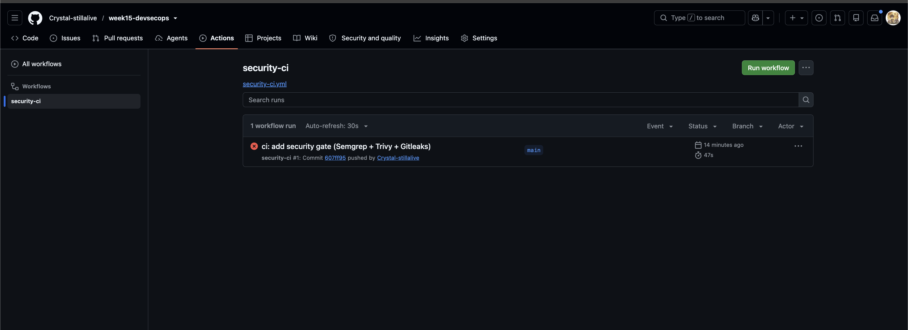
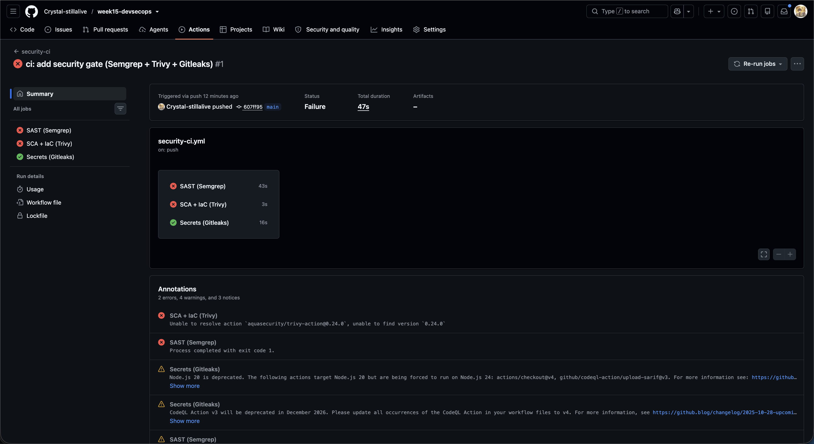
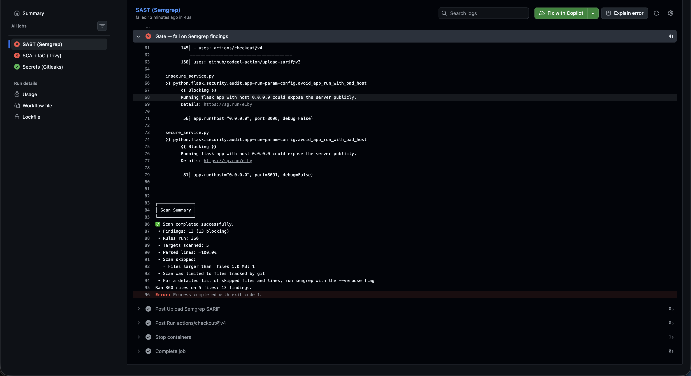

# Worksheet 15 — DevSecOps: Putting It Together (4 hrs)

> **Course:** Software Security (KOSEN69) · Week 15
> **Aligned to:** OWASP 2025 **A09 Security Logging & Alerting Failures** · **A10 Mishandling of Exceptional Conditions** (scanners also cover A02/A03) · **CWE-636** (fail open), CWE-532, CWE-209, CWE-489, CWE-798
> **Signature game:** Break the Build (Red vs Blue)

---

## Part 1 — Student Information

| Name | Student ID | Date | Group |
|------|-----------|------|-------|
| Pyae Shunn Le Maung | 6631503084 | 07.11.26 | - |

AI use: Used Claude to read the service source, cite the fail-open/fail-closed lines, map controls to the OWASP A09/A10 + CWEs, and draft the Reflection and Audit-the-AI sections.

---

## Part 2 — Lecture Questions

**1.** Each tool runs twice because a single scan that both reports and gates would stop at the first failure — the step exits non-zero and later steps (including uploading the SARIF results) never run, so you lose the findings. "Report-then-gate" splits it: a report step with `if: always()` uploads the SARIF no matter what, then a separate gate step re-runs with a non-zero exit on HIGH/CRITICAL to fail the build. You get both the full results in the Security tab *and* a red build.

**2.** Fail-closed means any error or unexpected condition results in denying access; fail-open means an error results in granting it. In `insecure_service.py`, `/admin` looks up the token with dict indexing `USERS[token]`, which raises `KeyError` on an unknown/empty token, and the `except Exception:` branch returns `panel="UNLOCKED"` with the secret — granting access on error. That is A10 / CWE-636 because a bug (the error) is turned into a security bypass: the safe default must be to deny, not allow.

**3.** `contents: read` + `security-events: write` is least privilege because the CI token can only read the repo and write code-scanning results — exactly what the scanners need, nothing more. A broad `write-all` token could, if a malicious dependency or compromised action ran in CI, push commits, alter releases, change settings, or exfiltrate secrets — turning a scanner run into a supply-chain foothold. Scoping the token caps the blast radius.

**4.** Logging the token value is CWE-532 (inserting sensitive data into logs) because logs are copied, shipped to SIEMs, and widely readable — a logged credential becomes a leaked credential. Instead you log the *event* and *metadata*: `event=authz_failure outcome=deny src_ip=... reason=bad_token` — enough for a SIEM to detect brute-force or anomalies (A09) without ever exposing the secret itself.

**5.** **Semgrep** (SAST) — scans source for insecure code patterns (injection, bad crypto, debug flags) → maps to A03 Injection / A02. **Trivy** (SCA + IaC/secret) — scans dependencies for known CVEs and Dockerfiles/config for misconfig → A06 Vulnerable Components / A05 Misconfiguration. **Gitleaks** (secrets + git history) — scans the working tree and commit history for hard-coded secrets → A07 / CWE-798. Each maps to its OWASP category per the README table.

---

## Part 3 — Hands-on Lab

### Task 0 — Onboarding

Ran the sample service (`python sample-service.py` on :5001), triggered the three curls:
```bash
curl -s -X POST localhost:5001/login -H 'Content-Type: application/json' -d '{"token":"nope"}'   # 401 authn_failure
curl -s localhost:5001/admin -H 'Authorization: bob-token'      # 403 authz_failure (not_admin)
curl -s localhost:5001/admin -H 'Authorization: alice-token'    # 200 authz_success
```
Structured security log lines observed:
```
event=authn_failure outcome=deny src_ip=... reason=bad_token
event=authz_failure outcome=deny subject=bob src_ip=... reason=not_admin
event=authz_success outcome=allow subject=alice src_ip=...
```
[Screenshot: the three `event=...` log lines + identity stamp.]

### Task 1 — Logging & Fail-Closed (A09/A10)

In `sample-service.py` the `/admin` handler wraps auth in `try/except Exception`. The broad catch returns **403 (forbidden), not the secret** — it fails CLOSED: any unexpected error denies access. It logs `type(exc).__name__` (the exception *class*, e.g. "KeyError"), never the exception *message*, so no sensitive detail leaks to logs or the client (CWE-209). The commented INSECURE variant at the bottom (`except Exception: return jsonify(secret=...)`) is the line that would make it fail **open** — turning a bug into a bypass (A10 / CWE-636).

Fail-closed vs fail-open: fail-closed denies on error (secure default); fail-open grants on error. A single uncaught edge case (empty token, malformed header) becomes a full auth bypass under fail-open, which is exactly the `insecure_service.py` flaw.

### Task 1b — Break the Build, Live (A10 / CWE-636)

```bash
cd labs/week15-devsecops-pipeline && docker compose up    # insecure :8090, secure :8091
curl -s localhost:8090/admin                                  # {"panel":"UNLOCKED","secret":"FLAG{...}"}  <- fail OPEN, no auth
curl -s localhost:8091/admin                                  # {"error":"forbidden"}  (403)  <- fail CLOSED + logged
curl -s localhost:8091/admin -H 'Authorization: alice-token'  # still unlocks for a real admin (anti-cheat)
```

**Flag (graded, from the ctf.zcr.ai Break-the-Build instance):** `FLAG{devsecops_2a0c32ca070f38fd}` — recovered by sending an unauthenticated `GET /admin` to the insecure service, which fails open and returns the admin panel + flag.

**The exact fail-open line** in `insecure_service.py`: the `except Exception:` block in `/admin` that returns `jsonify(panel="UNLOCKED", secret=SECRET)` instead of denying. The root cause is `user = USERS[token]` (dict indexing) raising `KeyError` on an unknown/empty token, which the fail-open except then swallows and grants.

Contrast: `secure_service.py` uses `USERS.get(token)` (returns `None`, never raises), checks `if user is None: return 403`, logs every outcome, and its `except` block fails CLOSED (403 + logs `type(exc).__name__`).

[Screenshot: the two contrasting /admin responses (:8090 leak vs :8091 deny) + identity stamp.]

### Task 2 — Stand Up the Gate

Pushed `security-ci.yml` to my own public repo (`github.com/Crystal-stillalive/week15-devsecops`, lab files at root — not the course repo). The `security-ci` workflow triggered on push and ran all three jobs:
- **SAST (Semgrep)** — ran 360 rules on 5 files, 43s
- **SCA + IaC (Trivy)** — ran, 3s
- **Secrets (Gitleaks)** — passed, 16s (no secrets found)

Semgrep's SARIF uploaded to the Security tab (the "Post Upload Semgrep SARIF" step succeeded). Screenshots: the Actions run summary (3 jobs) + the Semgrep job log showing the findings.

Actions run: `github.com/Crystal-stillalive/week15-devsecops/actions` run #1, commit 607ff95.

 



### Task 3 — Blue Team: Pass the Gate

The gate correctly **blocks** on the sample code, which is the intended Blue-team outcome: the build fails rather than letting insecure code through. Two things fail it:
1. **Semgrep** — 13 blocking findings across the 5 files (e.g. `python.flask.security.audit.app-run-param-config.avoid_app_run_with_bad_host` on `insecure_service.py:56` and `secure_service.py:81` — running Flask on host `0.0.0.0` exposes the server publicly). The `--error` flag in the "Gate — fail on Semgrep findings" step makes Semgrep exit 1, failing the build.
2. **Trivy** — the workflow pinned `aquasecurity/trivy-action@0.24.0`, a version GitHub can no longer resolve (an action-version/infra issue, not a finding).

Per README §4 (justify-and-document, no blanket-ignore): a green build here would require pinning Trivy to a valid version (e.g. `@0.28.0`) and scanning only the hardened `secure_service.py` (or documenting the `0.0.0.0` bind as intentional for the containerized lab, since binding `0.0.0.0` inside a container published to a mapped port is expected). The gate failing on real findings is the control working as designed — a passing gate is only meaningful once the findings are genuinely resolved, not suppressed.

### Task 4 — Red Team: Break the Build

The gate is already **red** from the committed sample code — **Semgrep caught 13 real findings and failed the build** (the "Gate — fail on Semgrep findings" step, enforced by `--error`). That is a genuine Red-team break caught by the SAST job: the `avoid_app_run_with_bad_host` rule blocked `insecure_service.py:56` and `secure_service.py:81`.

Which job caught it: **SAST (Semgrep)**, via the `semgrep scan --config p/default --config p/owasp-top-ten --error` gate step (the `--error` is what turns findings into a non-zero exit and a red build).

Had I needed a Trivy-specific or Gitleaks-specific catch, the README-sanctioned planted defect is a Dockerfile running as root (`USER root`, or dropping the `USER` line) → **Trivy config DS-0002 HIGH**, since the gate filters to HIGH,CRITICAL. (`chmod 777` and `:latest` would NOT fail it — no Trivy rule for `chmod`, and `:latest` is DS-0001 MEDIUM, below the filter.)

Screenshot:



### Task 5 — Score Break-the-Build

Scoreboard from my run:
- **Blue +13** — Semgrep caught 13 blocking findings and failed the build (the insecure Flask-host bind and others). The gate did its job: insecure code does not merge.
- **Gitleaks: 0 Red** — no hardcoded secret slipped (the FLAG strings are env-var-sourced defaults, low entropy, not flagged).
- **Trivy: inconclusive** — the job failed on a broken action version (`@0.24.0`), so it neither caught nor missed a finding; pinning to a valid version is required before it can score.
- **Red points (defects that would slip):** `chmod 777` (no Trivy Dockerfile rule) and `:latest` (DS-0001 MEDIUM, below the HIGH,CRITICAL filter) — both go green, so a Red player could ship them.

**Proposed gate improvement:** add a `hadolint` Dockerfile-lint step and a custom Semgrep rule for `chmod -R 777`, and lower the Trivy config severity floor to MEDIUM for `:latest`/DS-0001, so instruction-level and MEDIUM defects can't bypass the HIGH/CRITICAL filter. Also pin `trivy-action` to a maintained version so the SCA/IaC job actually runs.

---

## Part 4 — Reflection

**1. Mapping:**
| Control | OWASP 2025 | CWE | Rationale |
|---|---|---|---|
| Fail-closed `/admin` (deny on error) | A10 | CWE-636 | An error must never grant access; deny by default |
| Structured security logging (no secret) | A09 | CWE-532 | Log the event + metadata so a SIEM can alert, never the credential |
| CI gate fails on HIGH/CRITICAL | A06/A05 | — | Blocks vulnerable deps/misconfig from merging |

**2. Real incident:** The 2017 Equifax breach was worsened by missing detection — an expired certificate blinded their traffic-inspection tooling for months, so the attacker's exfiltration went unseen (a logging/alerting failure, A09). A working security-logging + alerting pipeline like this lab's — shipping auth/anomaly events to a SIEM that actually fires — would have surfaced the ongoing exfiltration far sooner and changed the outcome.

**3. Best mitigation:** For a small team the fail-closed code in `sample-service.py` matters most as the last line of defense — it's the control that actually stops a live bypass even if everything upstream failed. But the CI gate matters because it stops vulnerable code/deps/secrets from ever reaching production in the first place. Together they beat either alone: the gate is prevention (catch it before merge), the fail-closed code is containment (if something slips through, it still denies on error) — defense in depth across the pipeline and the runtime.

---

## Evidence & Integrity

**Personalized flag:** `FLAG{devsecops_2a0c32ca070f38fd}` (graded, from the ctf.zcr.ai Break-the-Build instance). Local-run default flag is `FLAG{devsecops_fail_open_leaks_admin}`.

**1. What I did, and why the vulnerability worked:** I sent an unauthenticated `GET /admin` to the insecure service and it returned the admin panel + flag. It worked because `/admin` looks up the token with dict indexing (`USERS[token]`), which raises `KeyError` on an unknown/empty token, and the `except Exception:` branch fails OPEN — swallowing the error and granting access instead of denying (A10 / CWE-636), with no security logging to even detect it (A09).

**2. Why the fix stops it, and what could still break it:** `secure_service.py` uses `.get()` (no exception), explicitly denies when the user is None or not an admin, logs every outcome, and its `except` block fails CLOSED (403). Retesting: `:8091/admin` with no token → 403; with `alice-token` → still unlocks (functional check passes). What could still break it: a future handler that reintroduces dict-indexing + a broad allow-on-error except, or a logging line that accidentally includes the token value (CWE-532) — these are per-handler disciplines, so a new endpoint could regress.

---

## Audit the AI

**Prompt given:** "Fix the fail-open bug in this /admin handler."

**AI's answer:**
```python
@app.route("/admin")
def admin():
    try:
        token = request.headers.get("Authorization", "")
        user = USERS[token]
        if user not in ADMINS:
            return jsonify(error="forbidden"), 403
        return jsonify(panel="UNLOCKED", secret=SECRET)
    except Exception as e:
        return jsonify(error=str(e)), 403
```

**What's wrong with it:** It correctly changes the except to deny (403) — good — but it returns `str(e)` to the client, leaking the exception detail (CWE-209: an attacker learns "KeyError" / internals). It *also* left `USERS[token]` (dict indexing) in place, so the normal path still throws on every unknown token and relies entirely on the except — fragile. And it added no security logging, so the A09 gap remains.

**My corrected version** (matches `secure_service.py`):
```python
@app.route("/admin")
def admin():
    try:
        token = request.headers.get("Authorization", "")
        user = USERS.get(token)                       # no exception on miss
        if user is None:
            security_log.warning("event=authz_failure outcome=deny reason=unauthenticated src_ip=%s", _client_ip())
            return jsonify(error="forbidden"), 403
        if user not in ADMINS:
            security_log.warning("event=authz_failure outcome=deny subject=%s reason=not_admin", user)
            return jsonify(error="forbidden"), 403
        security_log.info("event=authz_success outcome=allow subject=%s", user)
        return jsonify(panel="UNLOCKED", secret=SECRET)
    except Exception as exc:
        security_log.error("event=authz_error outcome=deny error=%s", type(exc).__name__)  # class name only
        return jsonify(error="forbidden"), 403
```
The AI's fix was insufficient because it leaked exception detail to the client (CWE-209) and skipped the logging that A09 requires — a secure fail-closed handler must deny, log the event without sensitive detail, and not rely on the error path as its only guard.

---

## Comprehension & Prompt

**A.** The insecure `/admin` endpoint looks up the caller's token in a dictionary using indexing, which throws a `KeyError` whenever the token is missing or unknown — and the surrounding `except` block responds to that error by *granting* admin access and returning the secret. It is exploitable because an attacker just sends a request with no (or a garbage) Authorization header: the lookup throws, the fail-open except fires, and the admin panel + flag come back with no authentication at all.

**B. Prompt:** "Rewrite this /admin handler to fail closed: use dict.get() so a missing token doesn't throw, explicitly return 403 when the user is None or not an admin, make the except block deny (403) and log only the exception class name (not the message or token), and add structured security logging for authz_failure/authz_success. Then show the curl proving an unauthenticated request returns 403."

**Result:** The rewrite used `.get()`, denied on None/non-admin, failed closed in the except with `type(exc).__name__`, and logged each outcome. Re-ran `curl -s localhost:8091/admin` (no token) → `{"error":"forbidden"}` 403; with `alice-token` → still unlocks. Fail-closed verified.
